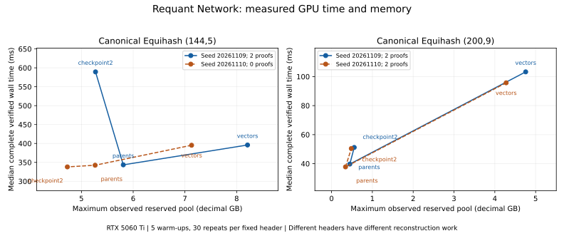

# Wagner time-memory research: final report

A research project by [Requant Network](https://requant.network). Research date: 2026-11-09. Raw timestamps use UTC where present.

## Finding

An original exact GPU solver completes canonical Equihash(144,5) and Equihash(200,9) on an RTX 5060 Ti 16 GB. Parent pointers substantially reduce memory compared with explicit leaf-index vectors. Discarding two early parent levels and recomputing them is valid, but it is not an automatic improvement: reconstruction time, whether a nonce produces candidates, and allocator retention determine the practical result.

The pinned TCHES CPU artifact also reproduces a useful time-memory trade-off on Ryzen 5 5500. Its tested hash convention differs from canonical Equihash, so its throughput cannot serve as a matching CPU baseline for our canonical GPU solver. Independent checking also finds repeated-index zero-XOR chains among its returned candidates. We retain and reject those chains as Equihash proofs, rather than counting every zero-XOR candidate as accepted work.

This is a bounded implementation and verification study. It demonstrates neither a new asymptotic algorithm nor a deployed miner, network submission, ASIC-resistance theorem or profitability result.

## Research basis

[Tang et al., Memory Optimizations of Wagner's Algorithm with Applications to Equihash](https://eprint.iacr.org/2025/2141), TCHES 2026, motivates reducing list-item/index storage instead of shrinking the initial search space. [On the Regularity of the Generalized Birthday Problem](https://eprint.iacr.org/2025/1351), CRYPTO 2026, motivates treating single-list and regular multi-list problems as distinct mathematical workloads. We test concrete implementations on consumer hardware without treating either paper's reported measurements as our results.

The CPU artifact is [Wagner-Algorithms](https://github.com/tl2cents/Wagner-Algorithms/tree/e53d92c7988bcb6868d702d44f15114e67e18c30), pinned at `e53d92c7988bcb6868d702d44f15114e67e18c30`. Canonical verification uses [Tromp's Equihash](https://github.com/tromp/equihash/tree/fab686ed3fac49dfd22624851025f31856728517), pinned at `fab686ed3fac49dfd22624851025f31856728517`. Original research code is MIT licensed; upstream sources retain their licenses and are not vendored into this repository.

## Mathematical contracts

For n hash bits and k collision levels, a candidate contains 2^k distinct leaf indices. Each recursively paired subtree must cancel the next n/(k+1) prefix bits; the final XOR must be zero. Tree ordering is canonical, with the lower first leaf on the left. A zero-XOR multiset with repeated leaves is not sufficient.

The canonical test header is 140 bytes, with a little-endian 32-bit test seed at offset 108 and all other bytes zero. BLAKE2b personalization is `ZcashPoW || LE32(n) || LE32(k)`. A digest contains floor(512/n) consecutive n-bit leaves and has length floor(512/n)*n/8 bytes. Collision digits consume bits most-significant first. This is a controlled header family, not a complete network-job interface.

The pinned CPU artifact instead hashes that header **plus 32 zero bytes**, always requests a 50-byte digest, uses two n/8-byte slices per digest, and consumes low bits within each byte first. The independent artifact oracle reverses bits within each byte to normalize its collision convention for the recursive verifier. This is a convention difference, not a cryptographic break. Each artifact proof is additionally tested with the canonical native verifier; its return code remains in the raw record.

[experiments/birthday.py](experiments/birthday.py) implements independent hashing, exact all-pairs CPU solving, canonical ordering and recursive verification. The CPU controls include ten complete small searches, 24 altered-proof checks and exhaustive four-leaf tree enumeration on a tiny fixture. A regular-list proof must additionally contain exactly one leaf from each origin list; intermediate joins are restricted to sibling origin groups.

## GPU solver and memory policies

[cuda/wagner.cu](cuda/wagner.cu) implements canonical BLAKE2b initialization, leaf hashing, join keys, exact pair counts and pair emission. A stable GPU sort groups matching collision prefixes. Counts use a 64-bit prefix sum. There are no bucket caps, dropped-overflow lists or silent pair truncations: an output-index or memory limit raises an error. The experiments complete within those limits.

Intermediate pairs sharing their minimum leaf are rejected because they already repeat an index. Other repeated-index candidates survive until full reconstruction and are rejected independently on CPU. This preserves valid distinct-index trees. Every emitted pair is represented in the counts; duplicate/invalid final candidates are explicitly reported. The implementation does not claim to enumerate every unconstrained zero-XOR subset, only the specified Wagner collision-tree problem.

The three policies are explicit vectors of all leaf indices, parent pointers at every level, and `checkpoint2`, which retains later parents but rebuilds the first two parent levels on demand. Rebuilt layers use the same hash/sort/order logic, making their parent indices reproducible. This GPU implementation is not the paper's in-place C++ APR algorithm. No claim equates their practical or asymptotic memory bounds.

Full canonical initial lists contain 2^17 leaves for (96,5), 2^25 for (144,5), and 2^21 for (200,9). All three policies return exactly the same accepted solution set for each tested nonce. Independent hashlib checks use 4,096 random index draws plus 32 boundary indices, deduplicated before checking; more than 4,000 unique leaves are checked per full parameter/cohort, with actual counts retained. Complete CPU solution-set comparison is also performed on the first (96,5) nonce and on all small/regular controls. Every accepted standard-parameter proof is checked by native Tromp at runtime; duplicate-index and changed-header negative controls are exercised when proofs exist.

## Campaign design and cohort accounting

The principal canonical cohorts use seeds 20261109..20261116 and 20261209..20261216: eight disjoint nonces per cohort, three parameters and three policies, for 144 complete cases. Policy order alternates with nonce parity; zero-solution nonces remain in the records and rate denominators. Eight nonces per cell do not justify a precise universal yield estimate.

An earlier second run, [gpu-replication.json](results/gpu-replication.json), uses 20261110..20261117 and overlaps seven nonces with the primary. It is retained as a **partially overlapping repeat control**, not counted as an independent eight-nonce replication. The additional [independent replication](results/gpu-independent-replication.json) closes that gap without modifying the original measurements.

Fixed-input latency studies use two different headers, five warm-ups and thirty timed repetitions per parameter/policy. They estimate latency on those inputs, not a 30-input success probability. A separate allocator study compares parent pointers, ordinary checkpoint2, and checkpoint2 releasing unused CuPy pool blocks before each early-layer rebuild. All retained parent arrays remain alive and the release cost is timed.

The CPU artifact uses eight disjoint nonces in each of two cohorts. Heights 0/3/4 are tested at (144,5), and 0/5/8 at (200,9). Each measurement uses a fresh process; heights alternate order. The native timer covers allocation, solving and reconstruction, with upstream zero-XOR checks and independent Python checks outside that timer. Process startup wall time and peak process RSS are retained separately. No fixed-input five/thirty policy is claimed for this stochastic CPU campaign.

## Canonical GPU results

Parent-pointer results across eight disjoint nonces per cohort, primary / independent replication. Rates include zero-yield inputs and independent verification:

| Parameters | Accepted proofs | Zero-accepted nonces | Median verified ms | Aggregate accepted proofs/s |
| --- | --- | --- | --- | --- |
| 144,5 | 13 / 19 | 1 / 0 | 342.252 / 342.822 | 4.750 / 6.938 |
| 200,9 | 15 / 15 | 0 / 2 | 37.660 / 35.033 | 48.914 / 50.731 |

These yields describe the controlled header family and small nonce cohorts. Four repeated-index final candidates are rejected in the primary (200,9) cohort per policy; none are rejected in its independent replication. Equal accepted sets across all three policies are checked, rather than treating raw candidates as successful work. No block reward or network work rate is inferred.

Fixed-input complete verified medians and maximum observed reserved pool, first latency header. Memory uses decimal GB:

| Parameters | Policy | Accepted proofs | Median ms | Observed pool GB |
| --- | --- | --- | --- | --- |
| 144,5 | Vectors | 2 | 395.963 | 8.210 |
| 144,5 | Parents | 2 | 343.462 | 5.809 |
| 144,5 | Checkpoint2 | 2 | 589.352 | 5.272 |
| 200,9 | Vectors | 2 | 103.257 | 4.756 |
| 200,9 | Parents | 2 | 39.718 | 0.448 |
| 200,9 | Checkpoint2 | 2 | 51.170 | 0.556 |

The exact accepted counts in this table must be read from the retained header-specific records; they do not represent average yield. In particular, the second (144,5) latency header has no candidate requiring retrieval. Its checkpoint path takes roughly 338 ms instead of 589 ms. Excluding unsuccessful nonces or treating every checkpoint run as equivalent would give a misleading cost model.

Native verification establishes full-parameter validity, not an independent exhaustive enumeration of every solution. Exact pair emission, complete small-instance controls and identical accepted sets across policies support the absence of truncation or policy-specific losses in the tested runs. They do not replace an independent full-parameter completeness proof.

For (200,9), releasing unused pool blocks reduces the primary follow-up's checkpoint reservation from about 556 MB to 454 MB, while increasing complete verified median from 51.609 to 53.254 ms. The corresponding parent-pointer measurement is about 448 MB and 37.096 ms. The other header also shows a reservation reduction, from about 485 MB to 403 MB, but parents remain about 342 MB and faster. Thus allocator retention explains part of the negative checkpoint result; the tested release policy does not make checkpoint2 dominate parents.

For (144,5), release does not reduce the observed maximum reservation in this experiment. When retrieval is required it adds overhead; when no candidate exists the recomputation branches are not invoked. These are conditional implementation results, not a rejection of all recomputation schedules.

Full stochastic counts, zero-solution nonces, duplicate rejections and accepted-proofs-per-second are in [stochastic-summary.csv](results/stochastic-summary.csv). The rate is total accepted proofs divided by the sum of complete verified wall times, retaining zero-yield nonces. [latency-summary.csv](results/latency-summary.csv) gives separate median/p95 measurements; repeated-input and independent-nonce summaries are not pooled.



The figure keeps fixed headers separate, including the zero-proof (144,5) input. Lines connect discrete measured policies; they are not theoretical trade-off bounds. Regenerate the standalone SVG with `python plot_results.py` using optional Matplotlib 3.11.2. This plotting dependency is not required for CPU verification.

## CPU artifact results and rejected chains

Full native solve/reconstruction medians and maximum process RSS. Each cell is primary / independent replication; accepted/rejected counts are per height over eight nonces, not unique across heights.

| Parameters | Height | Median ms | Maximum RSS MiB | Accepted | Rejected duplicate chains |
| --- | --- | --- | --- | --- | --- |
| 144,5 | 0 | 10977.643 / 11138.563 | 1454.477 / 1453.793 | 13 / 21 | 0 / 0 |
| 144,5 | 3 | 24920.656 / 24766.807 | 715.426 / 714.586 | 13 / 21 | 0 / 0 |
| 144,5 | 4 | 31759.787 / 31949.992 | 708.336 / 708.355 | 13 / 21 | 0 / 0 |
| 200,9 | 0 | 1302.668 / 1287.926 | 124.375 / 124.250 | 15 / 11 | 1 / 0 |
| 200,9 | 5 | 3535.850 / 3506.087 | 64.125 / 64.125 | 15 / 11 | 1 / 0 |
| 200,9 | 8 | 6025.762 / 5991.253 | 59.625 / 59.500 | 15 / 11 | 1 / 0 |

The largest tested switching heights approximately halve measured process RSS on both parameter sets, while increasing native solve/reconstruction time. Accepted sets remain identical across heights within each nonce. The two cohorts differ in yield, so unsuccessful nonces and invalid candidates must remain in the denominator. The primary cohort contains one repeated-index chain observed at each of three heights; the independent replication has no such rejection.

The upstream routine's `filter_trivial_solutions` removes a chain only when every index has even multiplicity. That is weaker than requiring all indices distinct. The independently diagnosed (200,9), seed 20261115 chain has 512 indices but 510 unique indices: XOR is zero, yet the distinct-index proof contract fails. This initially stopped the assertion-only harness. The final [author_campaign.py](author_campaign.py) retains every returned chain, records per-chain acceptance/rejection and compares accepted sets across heights. The original [author_study.py](author_study.py) remains unchanged to preserve the preflight's executed-source identity.

This observation is scoped to the pinned research artifact's candidate semantics. It is not a claim that a canonical network verifier accepts such chains. No upstream code was patched to improve the result, and no issue or message was sent upstream. Reported accepted rates exclude repeated-index chains while their solve/reconstruction costs remain included.

## Matched single-list and regular-list study

[regular_study.py](regular_study.py) compares the exact same hash values and initial leaf count in each pair: (24,2), 1,024 leaves with four origin lists of 256; (32,3), 512 leaves with eight lists of 64; and (48,3), 8,192 leaves with eight lists of 1,024. Both independent seeds are retained, along with every CPU/GPU solution, round sizes, memory observations and five/thirty GPU timings.

The single-list solver may select any distinct leaves satisfying its tree constraints. The regular solver imposes one-per-origin-list and sibling-group joins. These are different solution spaces even when the input values/count match. Lower regular-list work or fewer solutions therefore does not imply a faster solver for the original single-list puzzle or a mining advantage. Every retained solution set is compared with the independent complete CPU reference. [regular-summary.csv](results/regular-summary.csv) preserves both yields and work sizes, including zero-solution results. No full Requihash network protocol is implemented.

## Timing, memory and provenance

GPU `solve_wall_ms` includes fresh work-buffer allocations, hashing, sorting, joins, reconstruction and D2H candidate transfers. `complete_verified_wall_ms` additionally includes independent CPU validation and native standard-parameter checks. Garbage collection and release of unused cached blocks precede the timer. Fixed-input comparisons alternate policy order. The allocator follow-up's extra releases occur inside the timed computation.

Reserved CuPy pool bytes are observed after rounds and reconstruction passes; minimum free device memory is also sampled. These are allocation high-water observations at explicit synchronization points, not an instrumented trace of every transient CUDA allocation or whole-system memory peak. CPU process RSS includes executable/runtime overhead and is not directly interchangeable with GPU reserved-pool bytes or the paper's USS metric. Logical retained-parent/vector bytes and round cardinalities are recorded separately.

[native-build.json](results/native-build.json) records compiler flags, revisions and native binary hashes. Modern GCC rejects four old alignment typedef declarations in Tromp's BLAKE2 header. The build script makes an ignored build-only copy and moves those alignment attributes from typedef to struct; verifier/hash arithmetic bodies and the upstream checkout remain unchanged. This compatibility fix is disclosed rather than describing the entire verifier tree as byte-unmodified.

[build.json](results/build.json) binds measured CUDA/native builds to raw records and executed-source hashes. [environment.json](results/environment.json) records Linux, Ryzen 5 5500, RTX 5060 Ti, driver, CuPy/NumPy and compiler/runtime versions without host identities or credentials. CUDA 13.3.73 nvcc compiles the CUBIN for sm_120; CuPy uses its CUDA 12.x runtime/header environment. No research timing campaigns were intentionally overlapped. Clocks/power settings were unchanged; thermals, dynamic clocks and OS activity remain possible confounders. No TDP-derived energy estimate is made.

## Reproduction

CPU-only replay uses Python 3.12 standard library, without `-O`:

```sh
python cpu_study.py --output build/ci.json
python verify_proofs.py
python verify_campaigns.py
python verify_results.py
python summarize_results.py
git diff --exit-code -- results/*-summary.csv
```

For native/GPU reproduction, install g++ and a compatible CUDA/CuPy environment:

```sh
git clone https://github.com/tl2cents/Wagner-Algorithms.git upstream-author
git -C upstream-author checkout e53d92c7988bcb6868d702d44f15114e67e18c30
git clone https://github.com/tromp/equihash.git upstream-tromp
git -C upstream-tromp checkout fab686ed3fac49dfd22624851025f31856728517
python3 -m venv .venv
. .venv/bin/activate
python -m pip install -r requirements-gpu.txt
python build_native.py upstream-author upstream-tromp
/path/to/cuda-13.3/bin/nvcc -O3 -std=c++17 -arch=sm_120 -cubin cuda/wagner.cu -o build/wagner.cubin
export CUDA_PATH=/path/to/cuda-12.8
export CUDA_VISIBLE_DEVICES=0
export PYTHON=python
bash run_gpu.sh
bash run_gpu.sh --seed 20261209 --output results/gpu-independent-replication.json
bash run_gpu.sh --seed 20261110 --output results/gpu-replication.json
STUDY=latency_study.py bash run_gpu.sh
STUDY=latency_study.py bash run_gpu.sh --seed 20261110 --output results/latency-replication.json
STUDY=allocator_study.py bash run_gpu.sh
STUDY=allocator_study.py bash run_gpu.sh --seed 20261110 --output results/allocator-replication.json
STUDY=regular_study.py bash run_gpu.sh
STUDY=regular_study.py bash run_gpu.sh --seed 20261209 --output results/regular-replication.json
python author_study.py --trials 1 --output results/author-preflight.json
python author_campaign.py
python author_campaign.py --seed 20261209 --output results/author-replication.json
python record_environment.py
```

Run timed campaigns sequentially, with no competing research workload. The preflight is retained as a one-nonce diagnostic control; the complete artifact experiment is `author_campaign.py`. The post-run `collect_build.py` binds all listed records/binaries; compiler outputs need not be byte-identical on another platform. CPU CI replays retained proofs, exact small solution sets, coverage, hashes and generated tables. It does not rerun GPU kernels, rebuild native upstreams or claim that source hashes independently prove past timing.

## Conclusions and limits

Parent pointers are the strongest tested practical GPU baseline. Checkpoint recomputation preserves accepted solution sets but introduces input-dependent reconstruction cost and can increase physical allocation reservation. Testing allocator release prevents an implementation artifact from being mistaken for a mathematical impossibility; this particular release policy still does not dominate parents. The CPU artifact's measured reduction is useful within its own convention, with invalid repeated-index candidates explicitly excluded from accepted counts.

The regular-list experiment verifies a distinct constrained search problem. None of these observations establishes miner profitability or a new security bound. Different checkpoint schedules, a GPU in-place merge, narrower packing, optimized CPU canonical throughput, network integration, larger statistical cohorts and sampled energy are separate future studies. The committed required experiments are complete within the stated device and parameter scope.
