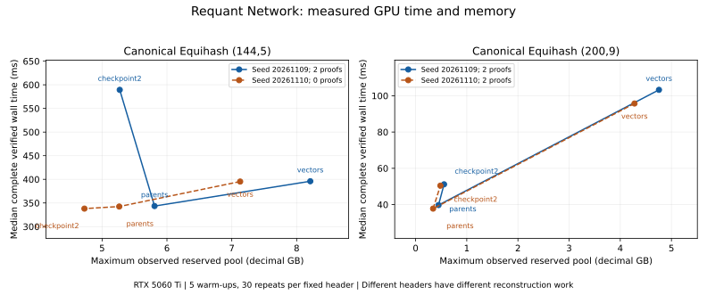

# GPU Wagner Research

Exact generalized-birthday search, canonical Equihash time-memory trade-offs and matched regular-list comparisons on consumer GPUs.

A research project by [Requant Network](https://requant.network).

**Research campaign completed: independent CPU references, native artifact reproduction, disjoint GPU nonce cohorts and final conclusions published.**

An original solver completes canonical **Equihash(144,5) and (200,9)** on RTX 5060 Ti 16 GB. Parent pointers substantially reduce memory compared with explicit leaf-index vectors. Rebuilding discarded early parent levels preserves accepted solution sets, but introduces input-dependent reconstruction cost and can increase allocator reservation.

Read the [final research report](FINAL_REPORT.md) for the complete mathematical contracts, native/GPU results, rejected candidates and reproduction details. [Stochastic](results/stochastic-summary.csv), [fixed-input](results/latency-summary.csv) and [matched-list](results/regular-summary.csv) summaries remain separate.

## Research question

Can reducing stored index information make a complete Wagner solver more memory-efficient on a consumer GPU, without silently dropping pairs or changing the set of accepted collision-tree solutions? How do reconstruction, memory allocation and regular-list constraints change the practical result?

This study measures complete controlled searches and independent verification. It does not implement a network miner or establish a new asymptotic algorithm, security bound, ASIC-resistance claim or reward estimate.

## Mathematical scope

For n hash bits and k collision levels, a proof contains 2^k distinct leaf indices. Each recursively paired subtree must cancel the prescribed n/(k+1) prefix bits, and the final XOR must be zero. Canonical tree ordering puts the lower first leaf on the left. A zero-XOR multiset with repeated indices is insufficient.

The canonical test family uses a 140-byte header, a little-endian 32-bit seed at offset 108 and BLAKE2b personalization `ZcashPoW || LE32(n) || LE32(k)`. Digest length is `floor(512/n)*n/8` bytes, with consecutive n-bit leaves and most-significant-first collision digits. Full lists contain 2^17 leaves for (96,5), 2^25 for (144,5) and 2^21 for (200,9).

The pinned TCHES CPU artifact uses a different hash convention: 32 extra zero bytes, fixed 50-byte digests, two slices per digest and low-bit-first consumption within bytes. Its outputs are checked under that convention and separately tested with canonical Tromp. **Its throughput is not a matching CPU baseline for the canonical GPU puzzle.**

## Implementations and completed experiments

The independent [CPU reference](experiments/birthday.py) provides hashlib leaves, exhaustive small searches, canonical ordering and recursive tree verification. The original [CUDA kernels](cuda/wagner.cu) hash leaves, form collision keys, count pairs and emit exact join outputs. Stable sorting and 64-bit prefix sums replace fixed bucket capacities; output-index or memory limits fail explicitly rather than truncate candidates.

| GPU policy | Stored information and reconstruction |
| --- | --- |
| `vectors` | Explicit leaf-index vectors at every level. |
| `parents` | Parent links at every level, expanded after the final join. |
| `checkpoint2` | Later parent links retained; the first two parent levels rebuilt on demand. |

The principal GPU campaign contains **144 cases**: three parameters, three policies, eight nonces per cohort and two disjoint cohorts. A separate earlier overlapping run is retained as a repeat control. Two fixed-header studies use five warm-ups and thirty observations per policy/parameter. Two allocator follow-ups test releasing unused pool blocks before reconstruction.

The native CPU campaign covers **96 cases**: two parameters, three switching heights and eight nonces in each of two disjoint cohorts, with a fresh process per measurement. Matched single-list/regular-list GPU studies additionally compare three workloads under two seeds against complete CPU solution sets.

## Measured findings

Complete verified GPU medians and maximum observed reserved pool for the first fixed header. Memory uses decimal GB; each parameter returns two accepted proofs under every policy:

| Parameters | Policy | Median ms | Observed pool GB |
| --- | --- | --- | --- |
| 144,5 | Vectors | 395.963 | 8.210 |
| 144,5 | Parents | 343.462 | 5.809 |
| 144,5 | Checkpoint2 | 589.352 | 5.272 |
| 200,9 | Vectors | 103.257 | 4.756 |
| 200,9 | Parents | 39.718 | 0.448 |
| 200,9 | Checkpoint2 | 51.170 | 0.556 |



The second (144,5) header has no candidate requiring reconstruction: checkpoint2 takes about 338 ms rather than 589 ms. Zero-yield inputs must therefore remain in the full statistics. Across the disjoint eight-nonce cohorts, parent-pointer medians are 342.252/342.822 ms for (144,5), and 37.660/35.033 ms for (200,9). Accepted yields and zero-solution nonces are retained in the [stochastic table](results/stochastic-summary.csv).

For (200,9), releasing unused cached blocks reduces the first allocator follow-up's checkpoint reservation from about 556 MB to 454 MB, but increases verified median from 51.609 to 53.254 ms. Parents remain about 448 MB and 37.096 ms in that follow-up. The second header also shows a reservation reduction without outperforming parents. This tests an implementation explanation for a negative result rather than rejecting recomputation in general.

Within the CPU artifact's own convention, larger switching heights approximately halve peak process RSS. For the primary (144,5) cohort, height 0 versus 4 changes maximum RSS from 1,454.477 to 708.336 MiB and median native solve/reconstruction time from 10.978 to 31.760 seconds. Accepted sets agree across heights. RSS, GPU pool reservation and the paper's USS are different resource metrics.

## Correctness evidence and rejected candidates

- Ten complete small CPU searches, 24 altered-proof rejections and exhaustive four-leaf tree checks on a tiny fixture.
- Full CPU/GPU solution-set comparison on all small/regular controls and the first (96,5) nonce of each main GPU campaign.
- More than 4,000 unique hashlib leaf checks per full parameter/cohort, drawn from 4,096 random indices plus boundary indices and then deduplicated.
- Native Tromp verification of every accepted standard-parameter GPU proof at runtime, plus duplicate-index and changed-header negative controls when proofs exist.
- CPU replay of 704 retained accepted proof occurrences across the published records, with negative controls and three rejected duplicate-index artifact observations.

The artifact's trivial-chain filter is weaker than the distinct-index Equihash contract. A returned (200,9) chain at seed 20261115 has 512 entries but only 510 unique indices; it has zero XOR but is rejected as a proof. The same chain is observed at three heights. The final harness retains every returned chain, validity flags and rejection counts; it excludes invalid chains from accepted rates while retaining their computation cost. This is an observation about the pinned artifact, not a claim that a network verifier accepts it.

## Cohorts and regular-list interpretation

Principal GPU nonce ranges are 20261109..20261116 and 20261209..20261216. The earlier `gpu-replication.json` uses 20261110..20261117, overlapping seven primary nonces, and is labeled a **partially overlapping repeat control**. The disjoint `gpu-independent-replication.json` supplies the independent replication. Fixed-input repetitions are latency observations, not independent searches.

Matched regular-list comparisons use the same initial leaf values/count in each pair: (24,2) with 1,024 leaves, (32,3) with 512 leaves and (48,3) with 8,192 leaves. The regular variant additionally requires one leaf per origin list and sibling-group joins. Its smaller work or yield cannot be interpreted as a faster solution to the unconstrained single-list task. These are scaled mathematical models, not a deployed Requihash protocol.

## Reproduce the CPU checks

Requires Python 3.12 and its standard library. Run without `-O`, because assertions are correctness gates:

```sh
python cpu_study.py --output build/ci.json
python verify_proofs.py
python verify_campaigns.py
python verify_results.py
python summarize_results.py
git diff --exit-code -- results/*-summary.csv
```

This reruns the independent small controls, replays retained canonical/artifact proofs, checks disjoint-cohort coverage and source/result hashes, and regenerates all three summary tables. CPU CI runs this path without CUDA or rebuilding native upstreams.

## Build native controls and prepare the GPU

Measured on Linux x86_64, Ryzen 5 5500 and RTX 5060 Ti 16 GB (SM 120), using g++ 13.3, Python 3.12, NumPy 2.2.6 and CuPy 13.6.0. CUDA 13.3.73 nvcc compiles the CUBIN; CuPy uses the pinned CUDA 12.x runtime/header environment.

```sh
git clone https://github.com/tl2cents/Wagner-Algorithms.git upstream-author
git -C upstream-author checkout e53d92c7988bcb6868d702d44f15114e67e18c30
git clone https://github.com/tromp/equihash.git upstream-tromp
git -C upstream-tromp checkout fab686ed3fac49dfd22624851025f31856728517
python3 -m venv .venv
. .venv/bin/activate
python -m pip install -r requirements-gpu.txt
python build_native.py upstream-author upstream-tromp
/path/to/cuda-13.3/bin/nvcc -O3 -std=c++17 -arch=sm_120 -cubin cuda/wagner.cu -o build/wagner.cubin
export CUDA_PATH=/path/to/cuda-12.8
export CUDA_VISIBLE_DEVICES=0
export PYTHON=python
```

`build_native.py` checks both pinned upstream checkouts. For modern GCC, it makes a build-only Tromp copy and moves four alignment attributes from typedef to struct in the BLAKE2 header. Verifier/hash arithmetic and the upstream checkout remain unchanged. The compatibility change and binary hashes are disclosed in [native-build.json](results/native-build.json).

## Reproduce the research campaigns

Run timed campaigns sequentially on a free GPU. Default output paths write the raw records under `results/`:

```sh
bash run_gpu.sh
bash run_gpu.sh --seed 20261209 --output results/gpu-independent-replication.json
bash run_gpu.sh --seed 20261110 --output results/gpu-replication.json
STUDY=latency_study.py bash run_gpu.sh
STUDY=latency_study.py bash run_gpu.sh --seed 20261110 --output results/latency-replication.json
STUDY=allocator_study.py bash run_gpu.sh
STUDY=allocator_study.py bash run_gpu.sh --seed 20261110 --output results/allocator-replication.json
STUDY=regular_study.py bash run_gpu.sh
STUDY=regular_study.py bash run_gpu.sh --seed 20261209 --output results/regular-replication.json
python author_study.py --trials 1 --output results/author-preflight.json
python author_campaign.py
python author_campaign.py --seed 20261209 --output results/author-replication.json
STUDY=record_environment.py bash run_gpu.sh
python summarize_results.py
```

`author_study.py` is the preserved one-nonce preflight harness. `author_campaign.py` is the complete campaign that records invalid returned chains instead of aborting on the known duplicate-index outcome. Post-run build collection uses the measured compiler location; see the [full reproduction notes](FINAL_REPORT.md#reproduction) when adapting the installation. The optional SVG figure can be regenerated with `python plot_results.py` and Matplotlib 3.11.2.

## Measurement boundaries

GPU solve wall time includes work-buffer allocations, hashing, sorting, joins, reconstruction and candidate downloads. Complete verified wall time adds independent CPU and native proof checks. Garbage collection and unused-cache release precede each timed call, except the allocator follow-up's deliberate releases inside reconstruction. Fixed-input cases use five warm-ups/thirty observations and alternate policy order. Stochastic cases retain independent nonces and all zero-yield outcomes.

Native CPU timing covers allocation/solve/reconstruction; independent verification is outside that timer. Process startup wall time and peak RSS are separate fields. GPU pool reservation and free-memory samples are observations at synchronization points, not an instrumented trace of every transient allocation. Native acceptance establishes validity; independent exhaustive full-parameter completeness is not claimed merely from verifier acceptance.

## Repository and research record

| Artifact | Purpose |
| --- | --- |
| [RESEARCH.md](RESEARCH.md), [METHODS.md](METHODS.md), [FINAL_REPORT.md](FINAL_REPORT.md) | Required scope, detailed methodology and final interpretation. |
| [RESULTS.md](RESULTS.md) | Complete raw-data index, including repeat controls and preflight. |
| [gpu_study.py](gpu_study.py), [cuda/wagner.cu](cuda/wagner.cu) | Exact canonical solver and memory policies. |
| [Primary GPU cohort](results/gpu-study.json), [independent replication](results/gpu-independent-replication.json) | Disjoint complete parameter/policy campaigns. |
| [Artifact primary](results/author-study.json), [replication](results/author-replication.json) | Native measurements, every returned chain and rejection evidence. |
| [Stochastic](results/stochastic-summary.csv), [latency](results/latency-summary.csv), [regular-list](results/regular-summary.csv) tables | Reproducible summaries with distinct timing/workload scopes. |
| [build.json](results/build.json), [native-build.json](results/native-build.json), [environment.json](results/environment.json) | Source/result/binary bindings, pinned upstreams and measured platform. |

## Limits and next research decisions

Parent pointers are the strongest tested practical baseline. Checkpoint schedules, allocation policies and the presence of final candidates determine reconstruction cost; the measured negative outcomes do not rule out other implementations. Small nonce cohorts limit yield estimates. Clocks and power settings were unchanged, but dynamic clocks, thermals and OS activity remain possible confounders. Energy, mining economics and network integration were not measured.

Further studies can test GPU in-place merges, narrower representations, alternative checkpoints, a matching optimized canonical CPU solver, larger cohorts and sampled energy. Regular-list theory and a working local collision search do not alone establish a deployable or profitable mining system.

## License and contributions

Original experiment code is [MIT licensed](LICENSE); upstream sources retain their own licenses. Contributions should include exact hash/tree conventions, pinned revisions, reproducible commands, independent proof checks, all rejected/zero-yield outcomes and explicit timing/memory boundaries. Reproducible negative findings are welcome.

## Primary references

- [Memory Optimizations of Wagner's Algorithm with Applications to Equihash, TCHES 2026](https://eprint.iacr.org/2025/2141)
- [On the Regularity of the Generalized Birthday Problem, CRYPTO 2026](https://eprint.iacr.org/2025/1351)
- [Pinned Wagner-Algorithms artifact](https://github.com/tl2cents/Wagner-Algorithms/tree/e53d92c7988bcb6868d702d44f15114e67e18c30)
- [Pinned canonical Tromp verifier](https://github.com/tromp/equihash/tree/fab686ed3fac49dfd22624851025f31856728517)

## Related Requant Network research

- [GPU algebra search](https://github.com/requant-network/gpu-algebra-search)
- [GPU erasure-code research](https://github.com/requant-network/gpu-erasure-research)
- [GPU ZK research](https://github.com/requant-network/gpu-zk-research)
- [GPU FHE research](https://github.com/requant-network/gpu-fhe-research)
- [GPU proof-of-useful-work research](https://github.com/requant-network/gpu-pouw-research)

## Follow-up closure, 12 November 2026

The [follow-up report](FOLLOWUP_REPORT.md) records the disposition of the concrete next steps: new experiments, negative findings and measured resource limits. The earlier completed campaign remains available for historical comparison. Run `python verify_followups.py` for the added evidence checks.
